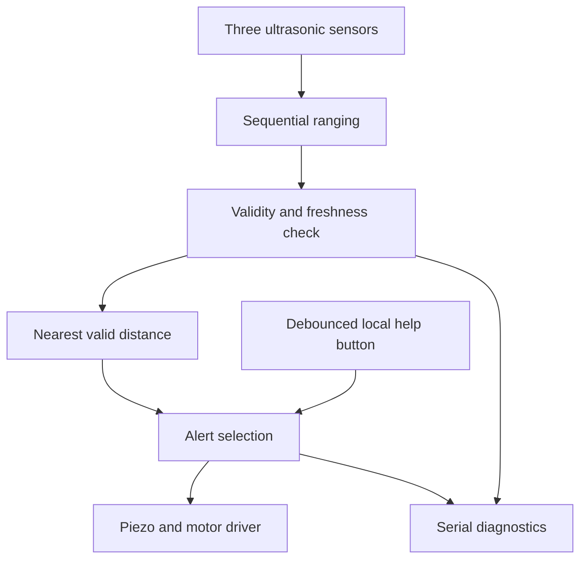

# Architecture and timing

One HC-SR04 is triggered every 70 ms. The trigger is held high for 10 µs and `pulseIn` measures ECHO with a 25 ms timeout. Echo microseconds / 58 gives an approximate integer distance in cm. Pulses outside 116–23200 µs are invalid. Temperature and real sensor behaviour affect accuracy.

Each sensor updates roughly every 210 ms; measurements older than 500 ms are stale. At startup all readings are invalid, so the initial state is UNKNOWN. Measurements are not synchronized, filtered or median-averaged. State selection uses the closest fresh valid distance. If that distance is <=120 cm, its proximity pattern takes priority even when another sensor is invalid; inspect valid_mask for degraded coverage. With no nearby valid reading and any missing measurement, emit UNKNOWN. Only complete fresh measurements all beyond 120 cm yield CLEAR, which is not a safe-path assertion.

The help button uses a 30 ms stable-input debounce and overrides alert patterns only while held. No latch, cellular link or emergency contact exists. Alert changes restart the pulse phase. Pulse timing and diagnostics use unsigned `millis()` subtraction; ranging remains bounded blocking, so actual pattern edges may be delayed by a measurement. A detected obstacle may take a sensor-refresh interval plus processing to change the output; measure the real latency.

The motor is driven via a MOSFET and flyback diode. The passive piezo uses `tone()`. No PWM dimming, motor speed regulation or direction cue is implemented. On UNO, tone timer interactions must be reviewed before adding PWM features. Current unit tests cover shared decision functions, not the complete Arduino loop or physical outputs.
