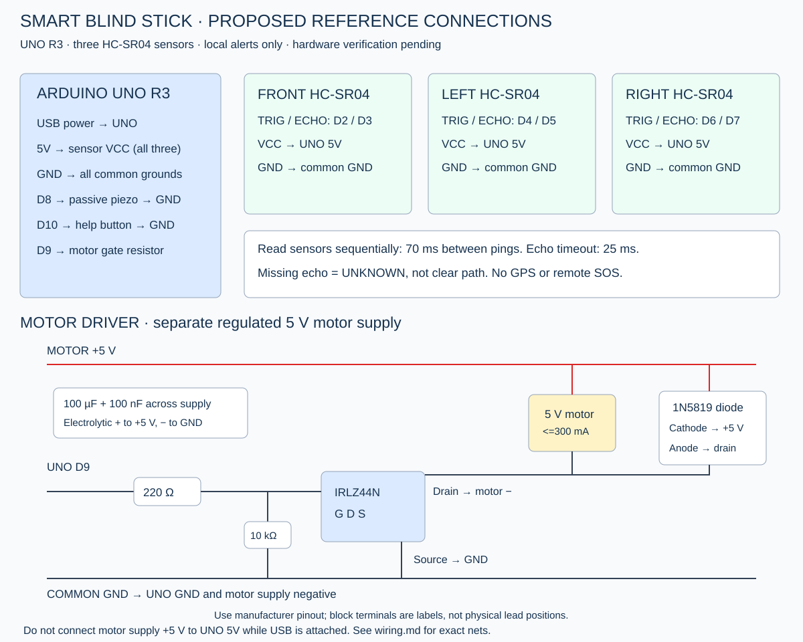

# Proposed reference circuit

New bench design, not verified against the user's original model. Power off while wiring; identify every terminal from the exact part's datasheet.

| Connection | UNO / destination |
|---|---|
| Front HC-SR04 TRIG / ECHO | D2 / D3 |
| Left HC-SR04 TRIG / ECHO | D4 / D5 |
| Right HC-SR04 TRIG / ECHO | D6 / D7 |
| Each HC-SR04 VCC / GND | UNO 5V / common GND |
| Passive piezo signal / other terminal | D8 / GND |
| Local help button | D10 to GND, INPUT_PULLUP |
| UNO D9 | 220 Ω series resistor to MOSFET gate |
| MOSFET gate to source | 10 kΩ pulldown |
| IRLZ44N source | Common GND |
| IRLZ44N drain | Motor negative |
| Motor positive | External regulated 5 V motor supply positive |
| External motor supply negative | UNO GND / common GND |
| 1N5819 diode cathode (band) | Motor positive |
| 1N5819 diode anode | Motor negative / MOSFET drain |
| 100 µF capacitor positive / negative | Motor supply +5 V / GND |
| 100 nF capacitor | Across motor supply +5 V / GND |

## Power and output stages

USB powers UNO and sensors. A separate regulated 5 V supply powers the selected 5 V vibration motor. Join grounds; **do not join the external motor +5 V to the UNO 5V pin while USB is connected**. Choose supply, wiring, capacitor voltage rating and diode for the motor's stall current; the proposed motor is limited to <=300 mA stall current. Verify its actual datasheet. Most coin motors are rated differently; do not apply 5 V to a 3 V motor.

The MOSFET switches the motor on/off. Use its manufacturer pinout, not a guessed left/right terminal order. The gate pulldown keeps the motor off during reset. The flyback diode is reverse biased in normal operation. Keep motor wiring short and decoupling near the driver.

D8 is only for a small, high-impedance passive piezo compatible with GPIO drive. An active buzzer or electromagnetic sounder needs an appropriate driver and different firmware. Verify its load before connecting.

UNO uses 5 V logic. This circuit must not be transferred directly to a 3.3 V ESP32: HC-SR04 ECHO voltage and MOSFET gate drive would need review.

## Mounting

Label front, left and right sensors. Initially test separately on a bench, then assess spacing and beam overlap. Sequential pings reduce overlap but do not prove cross-talk is eliminated. The proposed layout provides no validated drop-off or stair detection, weather resistance, enclosure or foldable shaft design.
